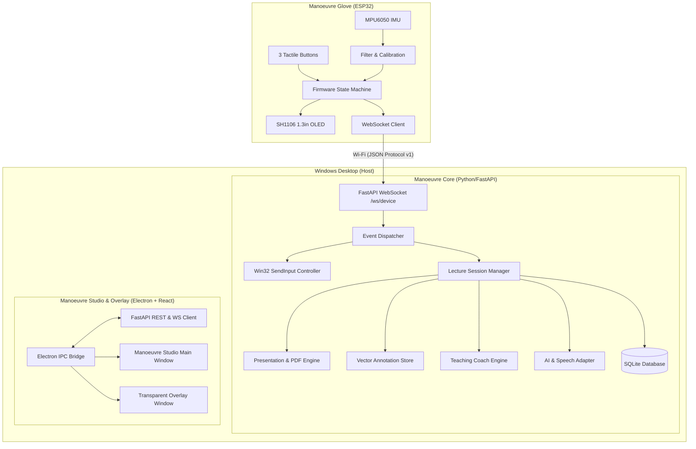

# Manoeuvre: System Architecture Specification

## 1. High-Level Architecture Overview

Manoeuvre is divided into three distinct runtime layers:
1. **Embedded Edge Tier (Manoeuvre Glove)**:
   - ESP32 microcontroller reading 3 tactile buttons (debounced) and an MPU6050 6-DoF IMU.
   - 1.3-inch SH1106 OLED (128x64) rendering device state and notifications.
   - Non-blocking state machine maintaining modes (CURSOR, ANNOTATE, HIGHLIGHT, VOICE).
   - Lightweight WebSocket client transmitting low-latency JSON events over Wi-Fi to the local desktop.
2. **Desktop Core Service Tier (Manoeuvre Core)**:
   - Local FastAPI service running on the host Windows machine (`localhost:8000`).
   - Async WebSocket handler managing the bidirectional device connection lifecycle.
   - Native Windows Input Controller using `SendInput` Win32 API for cursor control with dead-zones, sensitivity curves, and smoothing.
   - Presentation Controller managing PDF slides, layouts, and active lecture state.
   - SQLite Persistence Layer storing profiles, devices, presentations, sessions, vector annotations, and interactions.
   - AI & Speech Orchestration layer with provider-independent adapters (OpenAI, Gemini, Local Mock), OCR parsing, and Whisper transcription.
   - Teaching Coach analytics engine tracking slide pacing, transitions, and generating data-backed recaps.
3. **Desktop Presentation & Shell Tier (Manoeuvre Studio & Overlay)**:
   - **Manoeuvre Studio**: React 18, TypeScript, Vite, Tailwind CSS desktop application running inside an Electron container.
   - **Manoeuvre Overlay**: Transparent, always-on-top click-through secondary window for real-time laser pointer, drawing, and contextual AI card overlays directly above any presentation software or slide deck.
   - Secure IPC Bridge isolating renderer from privileged OS calls.

## 2. Component Separation & Decoupling Principles
- **No Direct Coupling**: Firmware never communicates directly with the React UI. It speaks through the canonical WebSocket protocol to Manoeuvre Core.
- **Provider Independence**: AI services adhere to an abstract interface. The application can seamlessly switch between Gemini, OpenAI, or offline test adapters.
- **Safe Hardware Fallbacks**: If physical hardware is disconnected, the Desktop app displays realistic disconnected state and provides an integrated virtual device simulator.
- **Context Isolation**: Electron renderer has `nodeIntegration: false` and `contextIsolation: true`. Privileged operations are mediated through a typed preload API.
