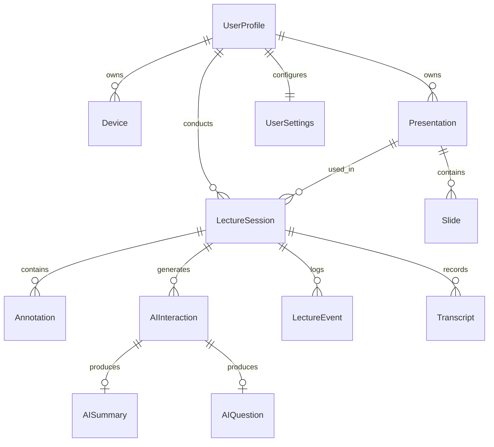

# Manoeuvre Database Design & Schema Specification

**Engine**: SQLite 3 with Foreign Key Constraints Enabled  
**File Location**: `manoeuvre.db` (in user application data / backend root)  
**ORM / Data Layer**: Pure Python dataclasses with an explicit Schema Migration & Repository Pattern (ensuring zero external ORM breakages and maximum speed and testability).

---

## 1. Entity-Relationship Overview



---

## 2. Table Schemas

### 2.1 `user_profiles`
```sql
CREATE TABLE IF NOT EXISTS user_profiles (
    id TEXT PRIMARY KEY,
    name TEXT NOT NULL,
    email TEXT,
    created_at TIMESTAMP DEFAULT CURRENT_TIMESTAMP,
    updated_at TIMESTAMP DEFAULT CURRENT_TIMESTAMP
);
```

### 2.2 `user_settings`
```sql
CREATE TABLE IF NOT EXISTS user_settings (
    user_id TEXT PRIMARY KEY,
    theme TEXT DEFAULT 'dark',
    cursor_sensitivity REAL DEFAULT 1.5,
    cursor_dead_zone REAL DEFAULT 0.15,
    cursor_smoothing REAL DEFAULT 0.8,
    zoom_factor REAL DEFAULT 2.0,
    highlight_color TEXT DEFAULT '#FACC15',
    overlay_opacity REAL DEFAULT 0.85,
    button_hold_threshold_ms INTEGER DEFAULT 500,
    ai_provider TEXT DEFAULT 'mock',
    ai_model TEXT DEFAULT 'gemini-1.5-flash',
    gemini_api_key TEXT DEFAULT '',
    openai_api_key TEXT DEFAULT '',
    language TEXT DEFAULT 'en',
    save_transcripts BOOLEAN DEFAULT 1,
    save_ai_interactions BOOLEAN DEFAULT 1,
    ws_port INTEGER DEFAULT 8000,
    created_at TIMESTAMP DEFAULT CURRENT_TIMESTAMP,
    updated_at TIMESTAMP DEFAULT CURRENT_TIMESTAMP,
    FOREIGN KEY(user_id) REFERENCES user_profiles(id) ON DELETE CASCADE
);
```

### 2.3 `devices`
```sql
CREATE TABLE IF NOT EXISTS devices (
    id TEXT PRIMARY KEY,
    user_id TEXT NOT NULL,
    device_name TEXT NOT NULL,
    mac_address TEXT UNIQUE,
    firmware_version TEXT,
    hardware_version TEXT,
    last_seen_at TIMESTAMP,
    is_active BOOLEAN DEFAULT 0,
    created_at TIMESTAMP DEFAULT CURRENT_TIMESTAMP,
    FOREIGN KEY(user_id) REFERENCES user_profiles(id) ON DELETE CASCADE
);
```

### 2.4 `presentations`
```sql
CREATE TABLE IF NOT EXISTS presentations (
    id TEXT PRIMARY KEY,
    user_id TEXT NOT NULL,
    title TEXT NOT NULL,
    file_path TEXT NOT NULL,
    file_type TEXT NOT NULL, -- 'pdf'
    page_count INTEGER NOT NULL DEFAULT 0,
    file_size_bytes INTEGER DEFAULT 0,
    checksum TEXT,
    created_at TIMESTAMP DEFAULT CURRENT_TIMESTAMP,
    updated_at TIMESTAMP DEFAULT CURRENT_TIMESTAMP,
    FOREIGN KEY(user_id) REFERENCES user_profiles(id) ON DELETE CASCADE
);
```

### 2.5 `slides`
```sql
CREATE TABLE IF NOT EXISTS slides (
    id TEXT PRIMARY KEY,
    presentation_id TEXT NOT NULL,
    slide_index INTEGER NOT NULL,
    title TEXT,
    extracted_text TEXT,
    ocr_layout_json TEXT, -- JSON structure of bounding boxes and words
    thumbnail_path TEXT,
    created_at TIMESTAMP DEFAULT CURRENT_TIMESTAMP,
    FOREIGN KEY(presentation_id) REFERENCES presentations(id) ON DELETE CASCADE,
    UNIQUE(presentation_id, slide_index)
);
```

### 2.6 `lecture_sessions`
```sql
CREATE TABLE IF NOT EXISTS lecture_sessions (
    id TEXT PRIMARY KEY,
    user_id TEXT NOT NULL,
    presentation_id TEXT,
    title TEXT NOT NULL,
    status TEXT NOT NULL DEFAULT 'ACTIVE', -- 'ACTIVE', 'PAUSED', 'COMPLETED'
    started_at TIMESTAMP DEFAULT CURRENT_TIMESTAMP,
    ended_at TIMESTAMP,
    total_duration_seconds INTEGER DEFAULT 0,
    total_slides_viewed INTEGER DEFAULT 0,
    total_annotations_count INTEGER DEFAULT 0,
    total_ai_queries_count INTEGER DEFAULT 0,
    recap_summary TEXT,
    FOREIGN KEY(user_id) REFERENCES user_profiles(id) ON DELETE CASCADE,
    FOREIGN KEY(presentation_id) REFERENCES presentations(id) ON DELETE SET NULL
);
```

### 2.7 `annotations`
```sql
CREATE TABLE IF NOT EXISTS annotations (
    id TEXT PRIMARY KEY,
    lecture_session_id TEXT NOT NULL,
    presentation_id TEXT NOT NULL,
    slide_index INTEGER NOT NULL,
    annotation_type TEXT NOT NULL, -- 'stroke', 'highlight', 'laser', 'text'
    color TEXT NOT NULL,
    stroke_width REAL NOT NULL,
    points_json TEXT NOT NULL, -- normalized vector coordinates [[x,y],...]
    created_at TIMESTAMP DEFAULT CURRENT_TIMESTAMP,
    FOREIGN KEY(lecture_session_id) REFERENCES lecture_sessions(id) ON DELETE CASCADE,
    FOREIGN KEY(presentation_id) REFERENCES presentations(id) ON DELETE CASCADE
);
```

### 2.8 `lecture_events`
```sql
CREATE TABLE IF NOT EXISTS lecture_events (
    id TEXT PRIMARY KEY,
    lecture_session_id TEXT NOT NULL,
    event_type TEXT NOT NULL, -- 'SESSION_START', 'SLIDE_CHANGE', 'MODE_CHANGE', 'ANNOTATION_ADD', 'AI_REQUEST', 'DEVICE_DISCONNECT'
    slide_index INTEGER,
    data_json TEXT,
    timestamp_ms INTEGER NOT NULL,
    created_at TIMESTAMP DEFAULT CURRENT_TIMESTAMP,
    FOREIGN KEY(lecture_session_id) REFERENCES lecture_sessions(id) ON DELETE CASCADE
);
```

### 2.9 `transcripts`
```sql
CREATE TABLE IF NOT EXISTS transcripts (
    id TEXT PRIMARY KEY,
    lecture_session_id TEXT NOT NULL,
    slide_index INTEGER,
    audio_duration_seconds REAL,
    raw_transcript TEXT NOT NULL,
    confidence REAL,
    created_at TIMESTAMP DEFAULT CURRENT_TIMESTAMP,
    FOREIGN KEY(lecture_session_id) REFERENCES lecture_sessions(id) ON DELETE CASCADE
);
```

### 2.10 `ai_interactions`
```sql
CREATE TABLE IF NOT EXISTS ai_interactions (
    id TEXT PRIMARY KEY,
    lecture_session_id TEXT NOT NULL,
    slide_index INTEGER,
    query_type TEXT NOT NULL, -- 'explain', 'summarize', 'mcq', 'assignment', 'analogy', 'code', 'recap'
    prompt TEXT NOT NULL,
    response_text TEXT NOT NULL,
    provider TEXT NOT NULL,
    model TEXT NOT NULL,
    latency_ms INTEGER,
    tokens_used INTEGER,
    error_message TEXT,
    created_at TIMESTAMP DEFAULT CURRENT_TIMESTAMP,
    FOREIGN KEY(lecture_session_id) REFERENCES lecture_sessions(id) ON DELETE CASCADE
);
```

### 2.11 `ai_summaries`
```sql
CREATE TABLE IF NOT EXISTS ai_summaries (
    id TEXT PRIMARY KEY,
    ai_interaction_id TEXT NOT NULL UNIQUE,
    key_takeaways_json TEXT NOT NULL, -- JSON array of strings
    main_concept TEXT,
    created_at TIMESTAMP DEFAULT CURRENT_TIMESTAMP,
    FOREIGN KEY(ai_interaction_id) REFERENCES ai_interactions(id) ON DELETE CASCADE
);
```

### 2.12 `ai_questions`
```sql
CREATE TABLE IF NOT EXISTS ai_questions (
    id TEXT PRIMARY KEY,
    ai_interaction_id TEXT NOT NULL UNIQUE,
    question_type TEXT NOT NULL, -- 'MCQ', 'SHORT_ANSWER', 'ASSIGNMENT'
    content_json TEXT NOT NULL, -- JSON payload of question options, correct answer, explanation
    created_at TIMESTAMP DEFAULT CURRENT_TIMESTAMP,
    FOREIGN KEY(ai_interaction_id) REFERENCES ai_interactions(id) ON DELETE CASCADE
);
```

---

## 3. Indexing Strategy
```sql
CREATE INDEX IF NOT EXISTS idx_sessions_user ON lecture_sessions(user_id);
CREATE INDEX IF NOT EXISTS idx_sessions_started ON lecture_sessions(started_at);
CREATE INDEX IF NOT EXISTS idx_annotations_session_slide ON annotations(lecture_session_id, slide_index);
CREATE INDEX IF NOT EXISTS idx_events_session ON lecture_events(lecture_session_id);
CREATE INDEX IF NOT EXISTS idx_slides_pres_idx ON slides(presentation_id, slide_index);
CREATE INDEX IF NOT EXISTS idx_ai_interactions_session ON ai_interactions(lecture_session_id);
```
